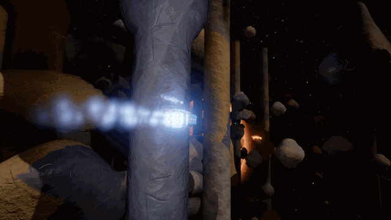
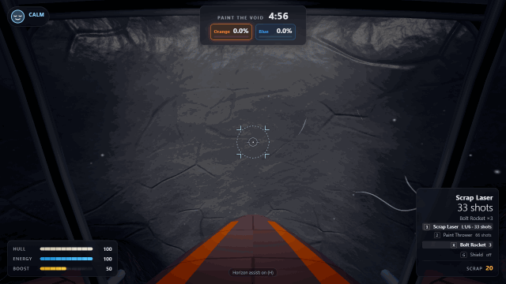
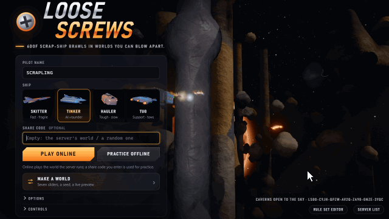
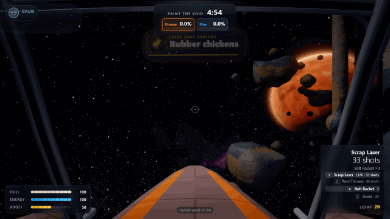
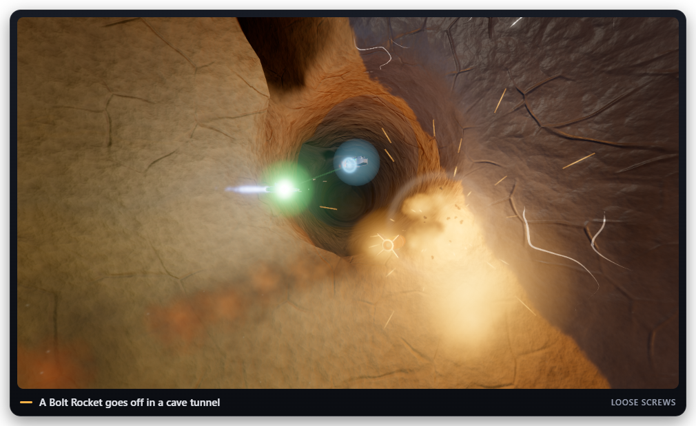
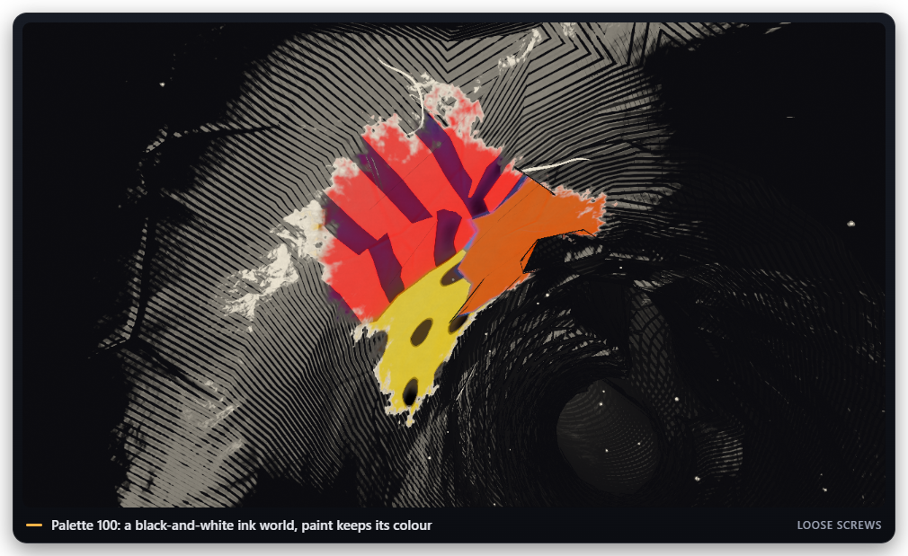
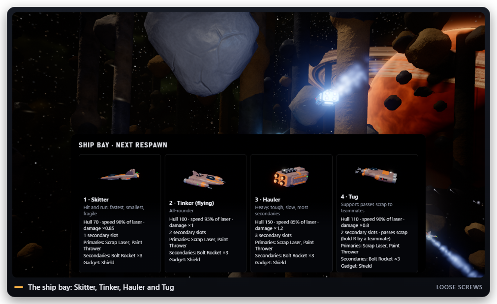
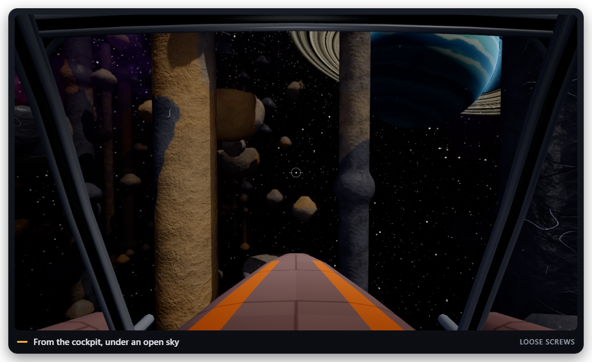
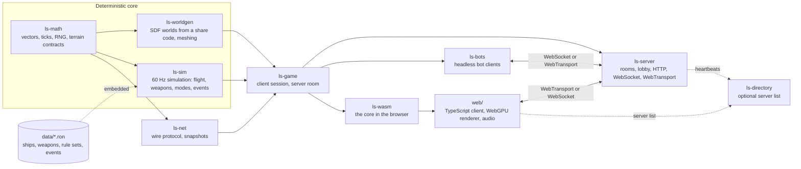

<p align="center">
  
</p>

# Loose Screws

[](LICENSE) [](LICENSE-CONTENT) 

**A fast, funny six-degrees-of-freedom arena shooter that runs in the browser.** You fly a
Scrapling, a palm-sized ship built from junk, through caverns, mine shafts and floating rock in
any direction you like. Every world grows from a short share code, so a link is all it takes to
play the same level, and every world can be blown apart: craters, cave-ins, paint and debris
stay for the rest of the match. The level has moods too, and now and then it plays a joke on
everyone. Underneath sits one deterministic Rust simulation: the authoritative server runs it
natively, the browser runs the very same code compiled to WebAssembly for prediction, and the
TypeScript client draws it with WebGPU. The level itself never crosses the wire; both sides
build it bit for bit from the share code.

**Why "Loose Screws"?** Every Scrapling is held together by scrap, tape and optimism, so
something is always about to come loose. The level has a few screws loose of its own: halfway
through a firefight it may rain hats, switch gravity off for a coffee break or turn every shot into
a rubber chicken. And whoever builds a shooter where the cave fights back is probably missing a
screw or two as well.

<p align="center">
  
  
</p>
<p align="center">
  
  
</p>

## Features

- **Six degrees of freedom.** Thrust, strafe, climb, roll and boost through tunnels with no
  fixed "up"; optional horizon assist levels you out.
- **Four junk ships** (Skitter, Tinker, Hauler, Tug) with coupled hull, energy and boost: boost
  refills from hard braking and near-miss wall scrapes, and overdrive burns hull for energy.
- **28 weapons and 3 gadgets:** 7 energy primaries, 3 kinetic primaries, 10 ordnance
  secondaries including the level-cracking Tectonic Charge, 8 comedy specials, and Shield,
  Cloak and Decoy. Every weapon has a bonus, a malus and a lasting effect on the level.
- **Worlds from a share code.** Seven sliders (Enclosure, Density, Verticality, Gravity Chaos,
  Palette, Absurdity, Instability) and a seed shape caverns, mine shafts, open sky with floating
  islands or a ring-shaped asteroid belt, with gravity wells and black-and-white ink worlds
  where pigment is power. The world workshop builds one with a live preview.
- **Destructible, paintable terrain.** Craters, melted channels, cave-ins, scorch and charge,
  debris you can push and scavenge, and paint colours that change how ships fly.
- **The level has moods.** A comedy director rolls 18 events (a cat paw, a duck parade, a tax
  drone, hat rain, rubber chickens and more), each announced before it happens; Absurdity 0
  turns them off.
- **Eight game modes:** Paint the Void, Team Brawl, The Squeeze, Heist, Hot Reactor, Last Color
  Standing, The Architect (one pilot reshapes the level live against everyone else) and Belt Up
  (a race around an asteroid belt), free-for-all or 2 to 4 teams, plus the Instagib mutator and
  one-on-one duels.
- **Rules you can share.** Rule set files and short `LR` codes, an in-browser rule set editor,
  weapon bans and server-wide balance lists.
- **Multiplayer that holds up:** an authoritative 60 Hz server, client prediction and
  reconciliation with the server's own physics, lag compensation, WebTransport with a WebSocket
  fallback, a lobby with a match rotation, private rooms, parties, invite links and an optional
  server list.
- **Headless bots** that fly the whole arsenal, play every mode for its objective and react to
  the comedy events.
- **A modern look and sound:** an HDR WebGPU renderer with bloom, dynamic lights, particles,
  sun shadows and quality presets; sound synthesized in the browser, with an announcer in
  three moods.

<p align="center">
  <picture>
    <source media="(prefers-color-scheme: dark)" srcset="docs/media/fight-dark.png">
    <source media="(prefers-color-scheme: light)" srcset="docs/media/fight-light.png">
    
  </picture>
  <picture>
    <source media="(prefers-color-scheme: dark)" srcset="docs/media/ink-dark.png">
    <source media="(prefers-color-scheme: light)" srcset="docs/media/ink-light.png">
    
  </picture>
</p>
<p align="center">
  <picture>
    <source media="(prefers-color-scheme: dark)" srcset="docs/media/ship-bay-dark.png">
    <source media="(prefers-color-scheme: light)" srcset="docs/media/ship-bay-light.png">
    
  </picture>
  <picture>
    <source media="(prefers-color-scheme: dark)" srcset="docs/media/open-sky-dark.png">
    <source media="(prefers-color-scheme: light)" srcset="docs/media/open-sky-light.png">
    
  </picture>
</p>

## Getting started

You need:

- **Rust** (stable, through `rustup`); `rust-toolchain.toml` installs the
  `wasm32-unknown-unknown` target, `rustfmt` and `clippy` on first use
- **wasm-bindgen CLI 0.2.129**, exactly this version:
  `cargo install wasm-bindgen-cli --version 0.2.129 --locked`
- **Node.js** 22.18+ or 23.6+ (built-in TypeScript type stripping) with npm
- **Chrome or Edge** with WebGPU (Firefox and Safari where WebGPU is enabled)

Build the client and run a server that serves it:

```sh
git clone https://github.com/Nusi42/LooseScrews.git
cd LooseScrews
cd web && npm install && npm run build && cd ..   # WASM core + TypeScript client into web/dist
cargo run -p ls-server --release                  # http://localhost:7777, a random world
```

Open <http://localhost:7777>, pick a ship and press **Play online**, or **Practice offline** to
fly alone (practice runs the simulation in the browser). Mouse to aim, W A S D to thrust and
strafe, Space and C to climb and sink, Q and E to roll, Shift to boost; the
[player manual](userDocs/player-manual.md#controls) lists every key.

Some company:

```sh
cargo run -p ls-bots --release -- --count 3       # three bots join ws://127.0.0.1:7777/ws
```

More ways to run it:

- `cargo run -p ls-server --release -- --code <share code>` plays a given world;
  `cargo run -p ls-server --release -- --help` lists every flag (rule sets, playlists, bans,
  ports, private rooms, the server list).
- `cd web && npm run dev` starts the client with hot reload (Vite on port 41873); online play
  goes to a server on port 7777.
- The [hosting guide](userDocs/hosting-guide.md) covers running a public server: ports,
  WebTransport, firewalls, playlists and the server directory.

## Architecture

One Rust core is compiled twice: natively for the authoritative server and the bots, and to
WebAssembly for the browser, where a thin TypeScript client handles input, sockets and drawing.
`ls-math`, `ls-worldgen` and `ls-sim` are deterministic (IEEE-exact float math, seeded random
streams, golden hashes in the tests), so a share code yields the same level everywhere and
client prediction uses the server's physics.



| Path | Contents |
| --- | --- |
| `crates/` | `ls-math`, `ls-worldgen`, `ls-sim`, `ls-net`, `ls-game`, `ls-server`, `ls-wasm`, `ls-bots`, `ls-directory` |
| `data/` | Ships, weapons, gadgets, rule sets, comedy events and world physics (RON), embedded into the simulation |
| `web/` | Browser client (TypeScript, Vite, WebGPU) |
| `tools/` | CI, determinism cross-check, end-to-end soak, headless browser smoke test, visual gallery, README media recorder |
| `docs/` | Developer documentation |
| `userDocs/` | Player manual, hosting guide and the reference tables generated from `data/` |

The full picture, from share code to rendered frame:
[docs/architecture/overview.md](docs/architecture/overview.md).

## Documentation

- [Player manual](userDocs/player-manual.md): controls, ships, weapons, modes, comedy events,
  share codes, playing with friends; [reference tables](userDocs/README.md) generated from the
  game data
- [Hosting guide](userDocs/hosting-guide.md): running `ls-server`, every flag, rule sets,
  playlists, the server directory
- [Developer docs index](docs/README.md): architecture, netcode, determinism, renderer, audio
- [Developer guide](docs/dev-guide.md): toolchain, building, tests, CI, bots, smoke test, visual
  gallery, adding weapons, gadgets and rule sets
- [Game design document](docs/design/game-design-doc.md): the rules of the game

## Status and roadmap

Playable and under active development. Four milestones are done:

1. **Vertical slice:** the deterministic core, world generation, netcode and Paint the Void.
2. **Arsenal and physics:** every weapon and gadget, ship types, debris, surface states, rule
   sets and their editor.
3. **Modes and lobby:** Team Brawl, The Squeeze, Heist, Hot Reactor, Last Color Standing,
   Instagib and duels; the lobby and match rotation, private rooms, parties, the server list.
4. **The level has moods:** the comedy director and its 18 events, all seven world sliders, ink
   worlds and pigment, The Architect, asteroid belts and Belt Up, the world workshop, sound.

Next is milestone 5, **platforms and ops** (planned): a Windows desktop app with a native UDP
connection, regional servers with Quick play, and bandwidth work for 32-player matches. The game
stays WebGPU only. Co-op modes, accounts and cosmetics come after that.

## Contributing

See [CONTRIBUTING.md](CONTRIBUTING.md) (Conventional Commits, the contributor license agreement). Start with the
[developer guide](docs/dev-guide.md) and the code rules in
[docs/code-quality.md](docs/code-quality.md) (single source of truth, one definition, no
duplicated logic). Tests live next to the code. Before handing in a change, run the full check:

```sh
tools/ci.sh            # Windows: pwsh tools/ci.ps1
```

It runs formatting, the generated-docs check, clippy with warnings as errors, the native and
wasm32 tests, the WASM and web builds, the WASM-versus-native determinism check and, when Chrome
or Edge is installed, the headless browser smoke test. The GIFs and stills above are recorded
by `node tools/readme-media/record.mjs` ([developer guide](docs/dev-guide.md#readme-media)).

## License

- **Code:** the [GNU Affero General Public License v3.0 or later](LICENSE). You may use, study,
  change and run Loose Screws, also in a closed version for yourself. If you distribute a changed
  version, or offer it to others over a network (for example by hosting a game server), you must
  make its source code available under the same license.
- **Content:** the game data in `data/`, the media in `docs/media/` and the game design
  document are licensed under [Creative Commons BY-NC-SA 4.0](LICENSE-CONTENT): share and adapt
  them with attribution, non-commercially, under the same license.
- **Name and logo:** "Loose Screws" and its logo are not covered by either license.
- **Other terms**, for example for commercial use, are available from the maintainer.
- **Contributions** come under the contributor license agreement in
  [CONTRIBUTING.md](CONTRIBUTING.md): you keep your copyright and allow the maintainer to offer
  your contribution under other terms too. Background: [ADR 0003](docs/adr/0003-licensing.md).

Current version: 0.4.0 (pre-1.0: playable, still changing).
