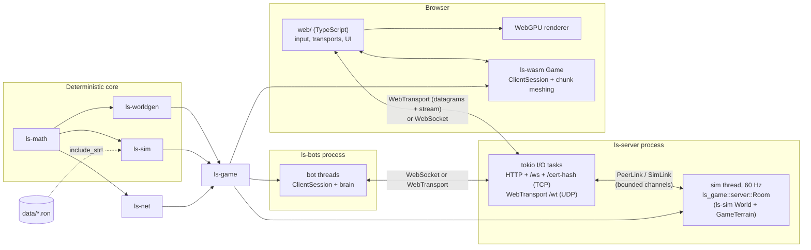

# Architecture overview

Loose Screws is one Rust core compiled twice: natively for the authoritative server and the
headless bots, and to `wasm32-unknown-unknown` for the browser, where a thin TypeScript +
WebGPU client handles input, networking sockets and drawing. Both sides build the level from
the same share code and run the same simulation code, so the level itself never goes over the
wire and client prediction uses the server's own physics.

Details live in the other pages: [contracts.md](contracts.md) (types shared across crates),
[game-glue.md](game-glue.md) (`ls-game`: client session, room, wire conventions),
[server.md](server.md) (hosting, transports, bots, e2e), [netcode.md](netcode.md) and
[determinism.md](determinism.md).

## Crates

| Crate | Kind | Responsibility | Deterministic |
| --- | --- | --- | --- |
| `ls-math` | lib | `Vec3`, `Quat`, `Mat3`, `Aabb`, `Tick` (60 Hz, `DT`), `det` (libm transcendentals), `SplitMix64` / `Pcg32`, and the terrain contracts (`TerrainEdit`, `SurfaceStates`, `TerrainQuery`, `RayHit`, test terrains) | yes |
| `ls-worldgen` | lib | `Sliders`, `ShareCode`, the SDF `Generator`, `ChunkStore` (32³ cells, lazy generation, edit log, surface layers: paint and timed surface states), rock material field (`material`: weak/rock/hard, crater strength), `surface_nets` and `dual_contouring` meshers, golden hashes | yes |
| `ls-sim` | lib | `World::step`: flight model, ship types (`ShipTable`), resources, data-driven weapons (`WeaponTable`) with one behaviour module per weapon, gadgets, entities (debris, decoys, ghosts, dust), rule sets v2 and codes (`RuleSet`), projectiles, splash, craters and paint, pickups, respawns, Paint the Void; `state_hash`, `data_hash`. Sees terrain only through `TerrainQuery` + `SimTerrain` ([arsenal-framework.md](arsenal-framework.md)) | yes |
| `ls-net` | lib | Wire protocol: bit packing, quantization (18 B ship state), `Message`s and handshake (data hash, ship choice), full and delta snapshots (ships, projectiles, generic entities, players), per-client `Relevance`, `SnapshotHistory`, the poll-based `Transport` trait and `MemoryTransport` | pure encoding |
| `ls-game` | lib | Glue with no I/O: `GameTerrain`, deterministic match setup (spawn and pickup points), sim <-> net conversion, `ClientSession` (prediction, reconciliation, interpolation, clock), and (feature `server`) the authoritative `Room` with lag compensation | uses the above |
| `ls-server` | bin + lib | Hosts one `Room`: 60 Hz sim thread, tokio I/O, HTTP static files, WebSocket `/ws`, WebTransport over UDP, `/cert-hash`, match restart, stats logging | no |
| `ls-wasm` | cdylib | wasm-bindgen API for the browser: share-code checks, `Game` (online `ClientSession` or offline practice `World`), chunk streaming and meshing, shot prediction, HUD and overlay data as flat arrays | no |
| `ls-bots` | bin + lib | Headless clients: one thread per bot, `ClientSession` plus steering/aim/brain, WebSocket or WebTransport, desync checks, exit codes | no |

Only the three deterministic crates follow the [determinism rules](determinism.md).
`ls-worldgen` and `ls-sim` never depend on each other: both implement or consume the
`ls_math::terrain` traits, and `ls-game` joins them (`GameTerrain` wraps the chunk store and
implements `ls_sim::SimTerrain`).

Non-Rust parts:

| Path | Contents |
| --- | --- |
| `data/weapons/*.ron`, `data/ships/*.ron`, `data/gadgets/*.ron`, `data/rulesets/*.ron` | Gameplay numbers. Embedded into `ls-sim` with `include_str!` (no file system in WASM) and hashed for the handshake; the server can also load a rule set file with `--ruleset` |
| `web/` | TypeScript (strict) + Vite client: `renderer/` (WebGPU), `input/`, `net/` (WebSocket and WebTransport transports), `game/` (session, chunk loader, camera, views), `ui/` (start screen, HUD, scoreboard, overlays), `wasm/` (loader and typed API over the wasm-bindgen package in `web/src/wasm/pkg`, generated and gitignored) |
| `tools/` | `ci.ps1` / `ci.sh` (full check), `determinism-check.mjs` (WASM vs native golden hashes), `e2e.mjs` + `e2e.ps1` / `e2e.sh` (server + bots soak run) |

## Crates and runtime components

## From share code to rendered frame

1. **Share code.** The server gets `--code` (or makes a random one) and a rule set
   (`--ruleset`, default the embedded Paint the Void rules). `ls_server::match_config` decodes
   the code (`ShareCode`: generator version, seed, 7 sliders, CRC-8) and validates the rule set
   against the built-in weapon table (`RuleSet::resolve`).
2. **Server world.** `ls_game::setup::build_match` creates the `Generator` from the code, wraps
   a `ChunkStore` in `GameTerrain`, computes spawn and pickup points from the pristine level
   (`match_setup`, seeded RNG streams) and builds the `ls_sim::World` at tick 0. `Room::new`
   pregenerates every chunk (paint coverage needs all surface cells).
3. **Handshake.** The browser (or a bot) connects, sends `Hello`, and receives a `Welcome` with
   its wire id and team, the share code, the rule set RON text, the quantization ranges, the
   current server tick and the whole terrain edit log.
4. **Client world.** `ClientSession::from_welcome` (inside `ls-wasm`'s `Game.fromWelcome`)
   regenerates the same level from the share code, replays the edit log, resolves the rule set
   and computes the same spawn and pickup points. Nothing about the level is downloaded;
   determinism guarantees it matches the server bit for bit.
5. **Each tick (server).** The sim thread applies each client's input for the tick (repeating
   the last one if it is missing), runs lag compensation, calls `World::step` (movement,
   firing, projectiles, craters and paint as `TerrainEdit`s applied to `GameTerrain`), records
   ship history, and every 2nd tick queues a snapshot per client, delta-encoded against that
   client's last acknowledged snapshot, carrying the terrain edits it has not acknowledged.
6. **Each animation frame (browser).** `web/src/main.ts` samples input, `GameSession.frame`
   drains received packets into `Game.handlePacket` (snapshots: apply edits, reconcile the
   predicted ship, buffer remote ships), then `Game.frame` runs the due 60 Hz ticks (predicts
   the local ship with `ls_sim::simulate_movement`, predicts own shots) and returns the
   `Input` messages to send.
7. **Meshing.** Terrain edits mark chunks dirty. `Game.meshNext(camera)` picks the next chunk
   (dirty ones first, then missing ones nearest the camera) and runs surface nets;
   `web/src/game/chunks.ts` spends a per-frame budget (4 ms / 8 chunks in play) and hands the
   `positions`/`normals`/`indices`/`team` arrays to the renderer.
8. **Drawing.** The renderer uploads chunk meshes (frustum culled, lit, team paint colours per
   vertex), and instanced ships and projectiles: the local ship from the prediction (plus the
   decaying correction offset), remote ships interpolated 100 ms in the past, projectiles
   extrapolated from the newest snapshot, own shots from the shot predictor. The HUD and
   overlays read flat arrays from `ls-wasm`.

Offline practice (`Game.practice(code, dummies)`) skips steps 1-3 and 5: the browser runs a
local `ls_sim::World` with idle dummies on the same level.

## Threads and ownership

- **Server:** one sim thread owns the `Room` (the `ChunkStore` sits in a `RefCell`, so
  `GameTerrain` is `Send` but not `Sync`); tokio tasks own sockets. They talk through
  `link_pair` channels: unreliable frames may be dropped under backpressure, reliable ones
  never (see [server.md](server.md)).
- **Browser:** single-threaded. The WASM `Game` owns the session, terrain and predictor; the
  TypeScript side owns the transport and GPU resources and frees WASM objects it receives.
- **Bots:** one OS thread per bot with a current-thread tokio runtime.
