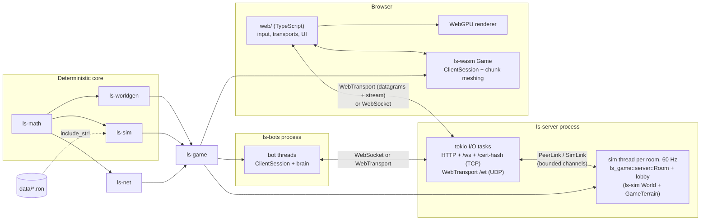

# Architecture overview

Loose Screws is one Rust core compiled twice: natively for the authoritative server and the
headless bots, and to `wasm32-unknown-unknown` for the browser, where a thin TypeScript +
WebGPU client handles input, networking sockets and drawing. Both sides build the level from
the same share code and run the same simulation code, so the level itself never goes over the
wire and client prediction uses the server's own physics.

Details live in the other pages: [contracts.md](contracts.md) (types shared across crates),
[game-glue.md](game-glue.md) (`ls-game`: client session, room, wire conventions),
[server.md](server.md) (hosting, transports, bots, e2e), [netcode.md](netcode.md) and
[determinism.md](determinism.md); the M2 weapons, gadgets, ship types and rule sets in
[arsenal-framework.md](arsenal-framework.md); the M3 modes, lobby, rooms, parties and duels in
[modes-and-lobby.md](modes-and-lobby.md).

## Crates

| Crate | Kind | Responsibility | Deterministic |
| --- | --- | --- | --- |
| `ls-math` | lib | `Vec3`, `Quat`, `Mat3`, `Aabb`, `Tick` (60 Hz, `DT`), `det` (libm transcendentals), `SplitMix64` / `Pcg32`, and the terrain contracts (`TerrainEdit`, `SurfaceStates`, `TerrainQuery`, `RayHit`, test terrains) | yes |
| `ls-worldgen` | lib | `Sliders`, `ShareCode`, the SDF `Generator`, `ChunkStore` (32³ cells, lazy generation, edit log, surface layers: paint and timed surface states), rock material field (`material`: weak/rock/hard, crater strength), `surface_nets` and `dual_contouring` meshers, golden hashes | yes |
| `ls-sim` | lib | `World::step`: flight model, ship types (`ShipTable`), resources, data-driven weapons (`WeaponTable`) with one behaviour module per weapon, gadgets, entities (debris, decoys, ghosts, dust), rule sets v2 and codes (`RuleSet`), projectiles, splash, craters and paint, pickups, respawns; game modes (one module per mode behind `ModeModule`: Paint the Void, Team Brawl, The Squeeze, Heist, Hot Reactor, Last Color Standing) and mutators (Instagib), teams 0-4, lives and spectators, the replicated `ModeView` and results; `state_hash`, `data_hash`. Sees terrain only through `TerrainQuery` + `SimTerrain` ([arsenal-framework.md](arsenal-framework.md)) | yes |
| `ls-net` | lib | Wire protocol (version 6): bit packing, quantization (18 B ship state), `Message`s and handshake (data hash, ship choice, room and party codes), full and delta snapshots (ships, projectiles, generic entities, players, mode state; predicted deltas and projectile settling), events and cues, `Inventory` and `SelectShip`, match transitions (epochs), lobby and results messages, the M4 mood view, ship ext bits, well entities and `ArchitectAction`, per-client `Relevance`, `SnapshotHistory`, the poll-based `Transport` trait and `MemoryTransport` | pure encoding |
| `ls-game` | lib | Glue with no I/O: `GameTerrain`, deterministic match setup (spawn and pickup points), sim <-> net conversion, `ClientSession` (prediction, reconciliation, interpolation, clock), and (feature `server`) the authoritative `Room` with lag compensation | uses the above |
| `ls-server` | bin + lib | Hosts a public room (lobby, warm-up, match rotation from a playlist) and up to `--private-rooms` private rooms, each a `Room` on its own 60 Hz sim thread, next rooms built on worker threads and swapped in without reconnects; tokio I/O, HTTP static files, WebSocket `/ws`, WebTransport over UDP, `/cert-hash`, a JSON API for presence, parties, custom matches and duels, the directory heartbeat, stats logging ([modes-and-lobby.md](modes-and-lobby.md)) | no |
| `ls-wasm` | cdylib | wasm-bindgen API for the browser: share-code checks, `Game` (online `ClientSession` or offline practice `World`), chunk streaming and meshing, shot prediction per weapon (`shots.rs`: patterns, fans, helices, nothing for instant weapons), mechanics views (`mechanics.rs`: cues, charge meter, gadget state, ship choice), inventory, HUD and overlay data as flat arrays | no |
| `ls-directory` | bin + lib | Optional server directory for the server list: heartbeats with a TTL, `GET /servers` (CORS, version/data-hash filter), invite relay; in memory, plain HTTP; `DirectoryClient` + `spawn_heartbeats` for `ls-server` ([directory.md](directory.md)) | no |
| `ls-bots` | bin + lib | Headless clients: one thread per bot, `ClientSession` plus global navigation (`nav.rs`; one grid build per world per process, shared by its bots: `nav_cache.rs`), steering, aim and a brain that uses every weapon (`arsenal.rs`: roles and range bands), gadget and ship type; WebSocket or WebTransport, per-weapon stats, desync checks, exit codes | no |

Only the three deterministic crates follow the [determinism rules](determinism.md).
`ls-worldgen` and `ls-sim` never depend on each other: both implement or consume the
`ls_math::terrain` traits, and `ls-game` joins them (`GameTerrain` wraps the chunk store and
implements `ls_sim::SimTerrain`).

Non-Rust parts:

| Path | Contents |
| --- | --- |
| `data/weapons/*.ron`, `data/ships/*.ron`, `data/gadgets/*.ron`, `data/rulesets/*.ron` | Gameplay numbers. Embedded into `ls-sim` with `include_str!` (no file system in WASM) and hashed for the handshake; the server can also load a rule set file with `--ruleset` |
| `web/` | TypeScript (strict) + Vite client: `renderer/` (WebGPU, [renderer.md](renderer.md): terrain with paint patterns, scorch and surface states; instanced ships, projectiles and entities; translucent effects; HDR with MSAA, bloom, colour grade and AgX tonemap; per-pass GPU timing; quality presets), `gallery/` (`?gallery=<scene>`: fixed-pose scenes for the visual gallery), `input/`, `net/` (WebSocket and WebTransport transports), `game/` (session, chunk loader, camera incl. the Eyeball view, views, `mechanics.ts`: cue effects, banners, charge and gadget lines), `ui/` (start screen with ship choice, HUD, ship bay, scoreboard, effects, overlays), `rules/` (rule set editor, `?editor=rules`, with a catalog generated from `data/`), `wasm/` (loader and typed API over the wasm-bindgen package in `web/src/wasm/pkg`, generated and gitignored) |
| `tools/` | `ci.ps1` / `ci.sh` (full check), `determinism-check.mjs` (WASM vs native golden hashes), `e2e.mjs` + `e2e.ps1` / `e2e.sh` (server + bots soak run; `e2e-rulesets/` for stress rule sets), `browser-smoke/` + `browser-smoke.ps1` / `.sh` (headless Chrome/Edge with WebGPU against real servers; `gallery.mjs`: fixed-pose screenshots and the GPU budget check) |

## Crates and runtime components

## From share code to rendered frame

1. **Share code.** The server gets `--code` (or makes a random one) and a rule set
   (`--ruleset` file or `LR...` rule set code, default the embedded Paint the Void rules, plus
   `--ban` and `--balance-list`; see [server.md](server.md#cli)). `ls_server::match_config` decodes
   the code (`ShareCode`: generator version, level archetype, seed, 7 sliders, CRC-8) and validates the rule set
   against the built-in weapon table (`RuleSet::resolve`).
2. **Server world.** `ls_game::setup::build_match` creates the `Generator` from the code (the
   last generator stage carves the connection network of caverns and tunnels that links both
   team ends plus the Heist site, `ls_worldgen::network`), wraps a `ChunkStore` in `GameTerrain`,
   computes spawn and pickup points from the pristine level (`match_setup`, seeded RNG streams;
   every point must reach the network in a straight line with 1.5 u of clearance) and the Heist
   core vein and extraction zones (`MatchSetup::heist`), and builds the `ls_sim::World` at tick 0. `Room::new`
   pregenerates every chunk (paint coverage needs all surface cells).
3. **Handshake.** The browser (or a bot) connects and sends `Hello` (name, protocol version,
   the hash of its built-in `data/` files, the ship type for the first life). A different data
   hash is rejected with `DataMismatch`. The `Welcome` carries its wire id and team, ship type,
   the share code, the effective rule set as RON text (after the server's balance list and
   bans), the quantization ranges, the current server tick and the terrain edit log (expired
   surface-state edits left out).
4. **Client world.** `ClientSession::from_welcome` (inside `ls-wasm`'s `Game.fromWelcome`)
   regenerates the same level from the share code, replays the edit log, resolves the rule set
   and computes the same spawn and pickup points. Nothing about the level is downloaded;
   determinism guarantees it matches the server bit for bit.
5. **Each tick (server).** The sim thread applies each client's input for the tick (repeating
   the last one if it is missing), runs lag compensation, calls `World::step` (movement with
   paint effects, gadgets, the hooks of each weapon's module, projectiles, entities and
   debris, pickups; craters, paint and surface states as `TerrainEdit`s applied to
   `GameTerrain`), records ship history, and every 2nd tick queues a snapshot per client:
   filtered by relevance (cloaked enemies, far debris), delta-encoded against that client's
   last acknowledged snapshot, carrying the terrain edits it has not acknowledged. Events and
   cues go out reliably with it, and a changed inventory as `Message::Inventory`.
6. **Each animation frame (browser).** `web/src/main.ts` samples input, `GameSession.frame`
   drains received packets into `Game.handlePacket` (snapshots: apply edits, reconcile the
   predicted ship, buffer remote ships and entities; events: cues for the mechanics UI), then
   `Game.frame` runs the due 60 Hz ticks (predicts the local ship with
   `ls_sim::simulate_movement`, predicts own shots per weapon) and returns the `Input`
   messages to send. `web/src/game/mechanics.ts` turns the frame's cues into banners, flashes
   and HUD lines.
7. **Meshing.** Terrain edits mark chunks dirty. `Game.meshNext(camera)` picks the next chunk
   (dirty ones first, then missing ones nearest the camera) and runs surface nets (vertices
   snapped onto the surface, continuous normals, baked ambient occlusion; since M4 A2 the
   vertices of cells with a sharp edge or corner placed on it by dual contouring's QEF, and
   rock thinner than a cell drawn whole; `crates/ls-worldgen/src/mesh.rs`);
   `web/src/game/chunks.ts` spends a per-frame budget (4 ms / 8 chunks in play; a further chunk
   starts only if the running average chunk time still fits) and hands the
   `positions`/`normals`/`indices`/`team` arrays (plus per-vertex surface states, rock
   materials, paint colours and occlusion) to the renderer.
8. **Drawing.** The renderer uploads chunk meshes (frustum culled, lit, team paint colours per
   vertex), and instanced ships and projectiles: the local ship from the prediction (plus the
   decaying correction offset), remote ships interpolated 100 ms in the past, projectiles
   extrapolated from the newest snapshot, own shots from the shot predictor, and generic
   entities (pickups, scrap, wrecks, debris, decoys, ghosts, dust) by their data-driven
   `Visual`. The HUD and overlays read flat arrays from `ls-wasm`.

Offline practice (`Game.practice(code, dummies)`) skips steps 1-3 and 5: the browser runs a
local `ls_sim::World` with idle dummies on the same level.

## A weapon across the crates

Every M2 weapon follows the same path, which is why a new one needs no changes outside its
own files (see [dev-guide.md, Adding a weapon](../dev-guide.md#8-adding-a-weapon)):

| Stage | Where | What happens |
| --- | --- | --- |
| Numbers | `data/weapons/<id>.ron` | `WeaponDef`: speed, damage, cost, splash, terrain effect, shield interaction, `visual`, free `params` |
| Behaviour | `ls-sim`: `weapons/<family>/<id>.rs`, registered in `weapons/registry.rs` | `WeaponBehavior` hooks queue `Command`s through `Ctx`; `World::step` applies them (damage pipeline with gadgets, knockback, edits, entities, cues) |
| Rules | `ls-sim`: `RuleSet::resolve_with` | availability, pickups, tuning and shield overrides per weapon; banned weapons never fire, spawn or get granted |
| Wire | `ls-net`, glue in `ls_game::convert` | projectiles (weapon id as `kind`, replicated state bits), generic entities with `VisualId`s, `NetEvent::Cue`, terrain edits; the data hash in `Hello` keeps builds apart |
| Client | `ls-wasm` `shots.rs`, `mechanics.rs`; `web/src/game/scene.ts`, `mechanics.ts` | own shots predicted per `ShotModel`, projectiles and pickups drawn from the `Visual`, cues turned into effects; names and slots from the data |
| Bots | `ls-bots` `arsenal.rs`, `brain.rs` | a `Role` per weapon id and a range band for primaries |
| Editor | `web/src/rules/catalog.ts` | generated from the data (`LS_BLESS_RULES_CATALOG=1 cargo test -p ls-sim --lib rulecode`) |

## Threads and ownership

- **Server:** one sim thread owns the `Room` (the `ChunkStore` sits in a `RefCell`, so
  `GameTerrain` is `Send` but not `Sync`); tokio tasks own sockets. They talk through
  `link_pair` channels: unreliable frames may be dropped under backpressure, reliable ones
  never (see [server.md](server.md)).
- **Browser:** single-threaded. The WASM `Game` owns the session, terrain and predictor; the
  TypeScript side owns the transport and GPU resources and frees WASM objects it receives.
- **Bots:** one OS thread per bot with a current-thread tokio runtime.
