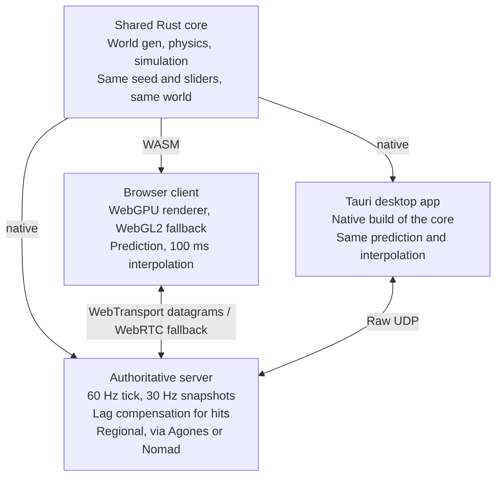

# Loose Screws — Game Design Doc

Sep 29, 2026

> Exported from the living design doc (a published page, not linked here).
> The online doc is the source of truth for design discussion; re-export this file after significant changes.

## Pitch and pillars

You fly a Scrapling, a palm-sized ship built from junk, through procedurally generated worlds that have moods, opinions and a bad sense of humor. The level is not a backdrop; it is a participant.

- **Every decision costs something.** Hull, energy and boost are coupled, and every weapon has a malus.
- **The level is a player.** Sliders shape it, the mood director messes with it, and terrain can be painted, grown and collapsed.
- **One click to play.** Runs in the browser, and any world can be shared as a short code or invite link.
- **Funny, but fair.** Comedy is tunable down to zero for ranked play; nothing that affects balance is ever sold.

## Core ship model

Three resources are deliberately coupled, so spending one always pressures another.

| Resource | Role | How it refills | Catch |
| --- | --- | --- | --- |
| Hull | Health | Scavenging: fly through debris from destroyed ships or level junk and hold R | Never regenerates on its own |
| Energy | Powers weapons and shields | Regenerates over time | Only while not boosting |
| Boost | Speed bursts | Kinetic energy: hard braking and near-miss wall scrapes | Rewards reckless tunnel flying |

**Overdrive gamble:** with energy empty, you can burn hull as energy at 2 hull per 1 energy. Desperate, but sometimes match-winning.

### Controls (6DOF, pointer lock)

| Input | Action |
| --- | --- |
| Mouse | Pitch and yaw |
| W / S | Thrust forward and back |
| A / D | Strafe left and right |
| Space / Ctrl | Up and down |
| Q / E | Roll |
| Shift | Boost |
| Left / right mouse | Primary and secondary weapon |

**Horizon assist** (optional, on by default for new players) slowly levels the roll to reduce motion sickness. Veterans can turn it off.

## Ship types

Three Scrapling hulls trade speed, damage and survivability against each other, and heavier ships carry more secondary weapon types at once. No type is strictly best, and a rule set can restrict which types are allowed. Values are tuning starting points.

| Ship | Top speed (vs laser) | Damage | Hull | Secondary types carried | Plays like |
| --- | --- | --- | --- | --- | --- |
| Skitter (light) | 98% | 0.85x | 70 | 1 | Hit and run; smallest hitbox, fastest turning |
| Tinker (standard) | 95% | 1x | 100 | 2 | All-rounder; the reference for every speed in this doc |
| Hauler (heavy) | 85% | 1.2x | 150 | 3 | Holds tunnels and soaks damage; largest hitbox |
| Tug (support, candidate fourth type) | 90% | 0.8x | 110 | 2 | Scavenges faster and can pass scrap to teammates |

Top speed means flying diagonally on all three axes at full boost. Picking up a secondary type when all slots are full swaps out the one you have selected.

**Every type stays slower than a laser**, so a bolt fired straight at a fleeing ship always gains on it; escaping relies on distance and the 3 s bolt lifetime.

## Weapons and gadgets

Weapons come in three families: slow energy bolts you can dodge, very fast kinetic rounds, and ordnance (missiles and mines). Every weapon has a bonus, a malus and a lasting effect on the level. Weapons come from both the mode's starting loadout and pickups in the level, and any weapon can be banned; see Match rules.

### Speed model

A pilot trichording at full boost reaches 95% of laser speed, while kinetic rounds travel 6 to 9 times faster than lasers but never instantly. Thrust is capped per axis, as in Descent, so flying diagonally on all three axes at once is 1.73 times (the square root of 3) faster than flying straight.

Units: 1 u = one ship length. All values are tuning starting points for the Tinker, the standard ship type.

| Mover | Speed (u/s) | vs laser | What it means |
| --- | --- | --- | --- |
| Ship, straight, cruise | 12 | 40% | Lasers easily catch a pilot flying in a straight line |
| Ship, straight, boost | 16.5 | 55% | Boost alone is not enough to escape |
| Missiles | 20 to 45 | 67% to 150% | Slow ordnance can be outflown; fast ordnance cannot |
| Ship, 3-axis diagonal, cruise | 21 | 69% | Trichording is the core movement skill |
| Ship, 3-axis diagonal, boost | 28.5 | 95% | A laser fired at your back closes at only 1.5 u/s |
| Laser bolt (energy baseline) | 30 | 100% | Takes 1 s to cross 30 u: a dodgeable skill shot |
| Kinetic rounds | 180 to 270 | 600% to 900% | Crosses 30 u in 0.11 to 0.17 s: needs a small lead, not hitscan |

**Rules:**

- Energy bolts expire after 3 s. A bolt fired at a fully boosting, trichording pilot more than 4.5 u away never catches them.
- Projectiles do not inherit the shooter's velocity, so every weapon's speed stays predictable.

### Arsenal

The arsenal follows Descent 2's structure: energy and kinetic primaries plus ordnance secondaries. Names are working titles; the Descent column is for reference only. Crater sizes are diameters in u.

**Energy primaries** use energy and fly at about laser speed, so good pilots can dodge them.

| Weapon | Behavior | Malus | Lasting effect | Descent 2 analogue |
| --- | --- | --- | --- | --- |
| Scrap Laser | Straight bolts at 30 u/s; 6 upgrade levels found as pickups | Weak at level 1 | Scorch marks; hit metal glows hot for 10 s | Laser 1 to 4, Super Laser 5 to 6 |
| Scatter Laser | 3 bolts in an alternating fan | Damage spreads thin at range | Fan-shaped scorch pattern | Spreadfire |
| Plasma Repeater | Rapid bolts at 33 u/s | High energy drain | Melts shallow pits into terrain | Plasma |
| Fusion Charger | Hold up to 2 s; damage and knockback scale with charge | Charging past 2 s burns your own hull | Melts a channel along its path and shoves debris aside | Fusion |
| Corkscrew | 5 bolts in a rotating fan | Wide pattern wastes energy at long range | Etches spiral grooves into walls | Helix |
| Ricochet Arc | Bolts bounce off walls up to 3 times | Bounces can hit you | Chips terrain at every bounce | Phoenix |
| Leech Arc | Short arc (12 u) that locks the nearest target and drains its energy into yours | Useless beyond 12 u | Surfaces stay charged for 15 s and drain energy from ships that scrape them | Omega |

**Kinetic primaries** fly 6 to 9 times faster than lasers. Proposal: they fire scrap, the same scavenged debris that repairs hull, so every shot competes with healing.

| Weapon | Behavior | Malus | Lasting effect | Descent 2 analogue |
| --- | --- | --- | --- | --- |
| Rivet Gun | 180 u/s, high rate of fire, light damage | Burns through scrap fast | Rivets embed in walls; knocks loose debris from weak terrain | Vulcan |
| Railspike | 270 u/s; heavy shots pierce ships and walls up to 2 u thick | Slow fire rate; muzzle flash reveals you | Drills straight holes through thin terrain that let light through | Gauss |
| Scrap Shotgun | 8 pellets at 200 u/s | Useless at range | Pockmarks walls and sprays fresh debris | None |

**Ordnance secondaries** are limited-count pickups that fly at 20 to 45 u/s.

| Weapon | Behavior | Malus | Lasting effect | Descent 2 analogue |
| --- | --- | --- | --- | --- |
| Bolt Rocket | Dumbfire, 40 u/s | Small blast | 2 u crater | Concussion |
| Seeker | Homes on the nearest target in a 30 degree cone, 25 u/s | Can be outflown or fooled by the Decoy | 2 u crater | Homing |
| Quicksilver | Fastest missile, 45 u/s | Small blast | 2 u crater | Mercury |
| Eyeball | You steer it through its camera, 25 u/s | Your ship is exposed while you steer | 4 u crater | Guided |
| Swarm Pod | 30 u/s; releases 6 homing blobs on impact | Blobs are weak alone | Scatter of small craters | Smart missile |
| Heavy Rocket | 20 u/s, 8 u blast | Very slow; hurts you at close range | 6 u crater that can open a passage between tunnels | Mega missile |
| Flash Pod | Blinds pilots within 15 u for 2 s | No damage | Surfaces glow for 30 s, lighting dark caverns and anyone inside | Flash missile |
| Prox Mine | Dropped behind you, arms after 1 s | Hurts you and teammates | Sticks to walls; 3 u crater | Proximity bomb |
| Stalker Mine | Creeps toward ships within 10 u | Slow | Leaves a scorched trail along its path | Smart mine |
| Tectonic Charge | See below | See below | Permanently reshapes the area | Earthshaker |

### Tectonic Charge (Earthshaker-class)

The Tectonic Charge devastates everything within 35 u and permanently reshapes that part of the level. Anyone near the impact has 1.5 s to boost away. It is the slowest projectile in the game, at 15 u/s.

1. **Launch:** a low rumble plays across the whole level, so everyone knows one is in flight.
2. **Impact:** the charge sticks to whatever it hits and the ground visibly cracks. The fuse runs 1.5 s.
3. **Detonation:** the main blast goes off, then splits into 6 sub-charges that scatter up to 20 u and explode 0.5 s later.
4. **Aftermath:** the collapse zone caves in, a dust cloud cuts visibility for 20 s, and a large debris field full of scrap is left behind. Loose debris everywhere in the level jostles from the shock.

| Zone | Radius (u) | Effect | Time to clear from impact at full boost |
| --- | --- | --- | --- |
| Core | 4 | Instant kill | 0.14 s |
| Damage | 25 | Heavy damage, falling off with distance | 0.88 s |
| Collapse | 35 | Terrain caves in whatever the Instability slider says; Instability sets how far cracks spread beyond this | 1.23 s |
| Shockwave | 60 | Knockback and screen shake; no damage | 2.1 s |

**Limits:** one Tectonic Charge spawns per map, with a 90 s respawn, and a ship can carry only one. It damages its owner like anyone else.

### Specials

The original comedy weapons sit beside the Descent-style arsenal as rarer pickups, and each now leaves a mark too.

| Weapon | Bonus | Malus | Lasting effect |
| --- | --- | --- | --- |
| Echo Cannon | Projectile returns along the same path after 2 s, so it can hit twice | The returning shot can hit you | Scorch trail along the out-and-back path |
| Swap Harpoon | On hit, you swap positions with the target | 4 s cooldown; you inherit their momentum | The harpoon spike stays in the wall as a small grab point |
| Paint Thrower | Reshapes the arena: red is bouncy, blue is slippery, yellow is sticky and slows ships | Deals no damage | Paint stays until painted over |
| Borrowed Time | Rewinds your position and hull by 3 s | Weapons offline for 3 s; a ghost stays visible at the old spot | Terrain damage is not rewound, so the scars stay |
| Magnet Sneeze | Cone pulls loose debris and enemies toward you; great for scavenging | Also pulls in mines thrown at you | Rips loose chunks off weak walls |
| Polite Laser | Very high damage | 1.5 s charge with an "excuse me" chime the target hears | Burns a clean hole through thin walls |
| Seed Grenade | Grows a small rock structure on impact: block tunnels or build cover | Small chance to grow something absurd, like a giant rubber duck | The structure stays until destroyed |

### Gadgets

**Gadgets** (one slot) each carry their own trade-off:

- **Shield:** mainly protects you from your own weapons, such as splash damage, ricochets and your returning Echo Cannon shots. Against enemy fire, each weapon has a shield setting: blocked, wears the shield down, or partly passes through to the hull. That setting is a main balancing lever and can be changed per weapon in match rules.
- **Cloak:** drains energy 3x while you are moving.
- **Decoy:** a copy of your ship that draws fire. When its timer runs out, it snaps back to you like a rubber band, very fast, and hits you for 99% of whatever integrity it has left. A decoy shot down to 50% hits you for about 50% x 99% of its full damage. Any ship in its path on the way back takes that hit instead, even a teammate, so a good pilot lines the return path up with an enemy.

## Weapon physics and lasting effects

Every hit leaves a mark that lasts the whole match, so a long fight visibly carves up the arena. Explosions push ships and debris around.

| Effect | Examples | Lifetime | Networked |
| --- | --- | --- | --- |
| Terrain edits | Craters, melted channels, drilled holes, collapses | Rest of the match | Yes, as compact edit operations |
| Surface states | Hot metal, static charge, glow, paint | 10 to 30 s; paint stays | Yes |
| Debris | Chunks knocked off walls, wrecks | Until scavenged; small pieces despawn past a cap | Large pieces yes; small pieces are cosmetic |
| Dust and smoke | After heavy explosions | About 20 s | Only its volume and timer |
| Scorch marks and decals | Laser scorch, embedded rivets | Rest of the match; the oldest fade past a cap | No; each client draws its own |

**Physics rules:**

- Every hit applies knockback in proportion to its damage; explosions push ships and debris outward.
- Terrain has strength per region. Repeated fire wears through walls, and weak materials break first.
- Debris is physical: it bounces, blocks shots, and can be shoved into enemies with the Fusion Charger or Magnet Sneeze.
- Proposal: gravity wells bend missiles and debris, but energy bolts and kinetic rounds fly straight, so aiming stays readable.
- The Instability slider scales how easily damage turns into collapses.

**Networking:** terrain edits are sent as parameters, such as "subtract a 3 u sphere at position P", so each edit costs about 16 B no matter how many voxels it touches. The server applies edits in tick order; every client re-runs them in the deterministic core and rebuilds the same mesh. Late joiners get the edit log with the share code, like the manual-edit delta list.

**Performance risk:** remeshing chunks after heavy explosions is the most expensive part. Caps on active debris per chunk and a remesh budget per frame belong in the first milestone.

## World generation

Generation is deterministic: the same seed plus the same slider values produce the same world on client and server.

| Slider | Low end | High end |
| --- | --- | --- |
| Enclosure (0 to 100) | Open sky at 0 | Dense mine shafts at 100; caverns in between |
| Density | Few obstacles | Many obstacles, pillars and floating rocks |
| Verticality | Sprawls flat | Stacks up and down |
| Gravity Chaos | Few, weak gravity wells | Many, strong local gravity wells |
| Palette | Full color | Pure black-and-white ink style, via desaturated |
| Absurdity | No comedy events | Frequent comedy events (see Comedy system) |
| Instability | Solid terrain | Highly destructible; tunnels collapse often |

**Technique:** terrain is voxel SDF chunks of 32 x 32 x 32 cells, meshed with dual contouring for crisp, mine-like edges. Open sky uses sparse floating islands on the same system, so one generator covers the whole Enclosure range.

**Share codes:** the Save button encodes a 64-bit seed, the slider values and the generator version into a code of about 20 characters, for example `LSx-7KQ2-M9FA-P0Z1`. Manual edits made after generation are stored as a separate delta list. Share codes double as invite links.

**Monochrome levels as gameplay:** black-and-white levels contain pigment pickups. Carrying pigment colors your ship: stronger weapons, but visible to everyone. Staying gray blends you into the ink-shaded world. It is a stealth-versus-power trade-off.

## Game modes

PvP supports 2 to 32 players and coop 1 to 8. The Architect mode works in both.

| Mode | Type | Players | Core rule |
| --- | --- | --- | --- |
| Paint the Void | PvP, teams | 2 to 32 | Claim territory by painting surfaces; score is the percentage of the level in your team's color |
| Heist | PvP | 2 to 32 | Mine a core deep in a collapsing mine and carry it to the surface; the carrier cannot boost |
| Hot Reactor | PvP | 2 to 32 | Pass the reactor around; whoever holds it at detonation loses a life. It detonates faster the more ships are near it |
| Last Color Standing | PvP | 2 to 32 | Monochrome level; kills drain the victim's color, and the last player with any color wins |
| Duel Invites | PvP | 2 | Challenge any player on the server list directly, with a custom seed |
| Team Brawl | PvP, 2 to 4 teams | 4 to 32 | Team deathmatch with respawns; the first team to reach the kill target wins |
| The Squeeze | PvP, free-for-all | 2 to 32 | The outer areas of the level close in over time; no respawns, and the last ship flying wins |
| Deep Dig | Coop | 1 to 8 | Descend an endlessly generated mine against a timer; difficulty rises with depth |
| Tethered | Coop | 1 to 8 | All players are chained together with elastic rope physics |
| Escort the Intern | Coop | 1 to 8 | Protect an AI ship that makes bad decisions, like stopping to admire the view |
| The Architect | Asymmetric coop or PvP | 1 to 8 (coop) | One player moves the sliders live within a budget; the others must survive to the exit |
| Belt Up (proposal) | PvP, race | 2 to 8 | Race from symmetric start slots in an asteroid belt to the exit; the belt shields you from radiation but is full of rock, open space is fast but burns your hull; shoot, sneeze, bump and drop gravity wells to bend your rivals' paths |

### The Squeeze

The squeeze is the terrain itself: walls grow inward from the level boundary, so tunnels narrow before they seal and anything caught between them is crushed. The generator does this by adding a growing solid shell to the terrain field, so it needs no separate zone system.

- **Phases:** each phase warns for 20 s (walls glow and grind, and the next safe zone shows on the map), then closes over 30 s. Timings are tuning starting points.
- **Safe zone:** its center comes from the seed and shifts each phase, always inside the previous zone.
- **Crushing:** contact with a moving wall deals heavy damage every second.
- **Scrap:** closing walls shed debris inward, so late-game survivors can still scavenge hull and ammo.

### Belt Up

*Proposal.* A race to an exit through an asteroid belt. The level is a ring of asteroids around an open centre, copied 8 times around the vertical axis and mirrored above and below the belt plane, so every start slot flies exactly the same course. Values are tuning starting points; details in milestone-4-plan.md §3.8.

- **Course:** one lap around the ring through 8 gates (600 to 900 u, depending on how far inside you fly), then a dive to a giant green EXIT sign at the centre. A match is 3 heats; points per place (10, 8, 6, 5, 4, 3, 2, 1), most points wins.
- **Radiation:** the belt's dust shields you. Outside it, radiation burns your hull, faster the farther out you fly, and shields do not stop it. The belt is safe but crowded (its inner edge is the shortest line and the densest), open space is fast but hot. Hull never regenerates: shoot asteroids and scavenge their scrap if you need more.
- **Changing paths:** every weapon works. Magnet Sneeze pulls the racer ahead back to you, Swap Harpoon trades places with them, mines wait in the racing line, ships bump each other by mass, shepherd moons (Gravity Chaos) and the new Paperweight bend everyone's path. The Paperweight is a thrown stone that stops where it lands and becomes a small gravity well for 6 s; afterwards the debris it gathered stays as a floating lump of rock.
- **Obstacles:** static asteroids you can blast through, plus boulders that drift around the ring and shove you aside.
- **Death:** you respawn at the last gate after 4 s with the hull you had there, so dying is never a free repair.
- **Comedy:** the level's mood still has its say; events that would break the symmetry (Bored level, Wrong genre, Moving day) sit out, and the duck parade flies the wrong way round the ring.

### Mutators

**Instagib** works on any PvP mode, such as Team Brawl, The Squeeze or a duel.

- Every ship carries only the Railspike, with unlimited ammo, and any hit kills.
- No pickups and no gadgets; hull and energy are hidden, but boost stays, because movement is the skill.
- Railspike rounds still travel at 270 u/s rather than instantly, so shots need a small lead.
- Lasting effects stay on: drilled holes pile up and open new sightlines as the match goes on.
- Modes with respawns respawn you instantly.

### Match rules

Every mode ships with a default rule set that decides the starting loadout, which weapons spawn in the level, and which are banned. Hosts can edit rule sets for custom matches, and ranked playlists use locked rule sets that we maintain.

Each weapon gets one of four availability settings:

| Availability | Meaning |
| --- | --- |
| Loadout and pickup | Players spawn with it and can find ammo and upgrades in the level |
| Pickup only | Spawns only in the level |
| Loadout only | Given at spawn; never found in the level |
| Banned | Not available in this match |

The other settings in a rule set:

| Setting | Options | Default |
| --- | --- | --- |
| Weapon availability | Per weapon, as above | Set per mode |
| Starting loadout | Primaries, secondaries with counts, gadget | Set per mode, for example Scrap Laser and 3 Bolt Rockets |
| Pickup spawns | Spawn weight and respawn time per weapon; spawn points placed by the generator from the seed | Set per mode; Tectonic Charge 1 per map, 90 s respawn |
| Shield interaction | Per weapon: blocked, wears the shield down, or partly passes to the hull | Tuned default table |
| Weapon tuning | Per weapon multipliers for damage, fire rate and ammo | 1x |
| Ship types | Which types may be picked | All |
| Friendly fire | Off, or 10% to 100% | 50% in team modes |
| Absurdity | 0 to 100 | Per playlist; 0 in the Serious playlist |
| Mutators | Instagib, more later | Off |

**Balance control:**

- Weapon stats live in data files, not code, so a weapon can be retuned or banned without a client update.
- For ranked play, the server pushes a live balance list. If a weapon turns out to be overpowered, it is banned or weakened across ranked playlists at once and returns once fixed.
- Custom matches ignore the live list unless the host opts in.
- The authoritative server enforces the rule set, so clients cannot spawn banned weapons.
- Rule sets save and share as their own short code, like worlds. An invite link carries both the world code and the rule set code.

## Comedy system: The Level Has Moods

A director AI rolls events, weighted by the Absurdity slider. Events stay rare in ranked play, and a Serious playlist locks Absurdity to 0.

| Event | Effect |
| --- | --- |
| Bored level | The level rotates 90 degrees over 5 s |
| Tax drone | Chases the leading player and steals 10% of their energy |
| Gravity coffee break | All gravity wells switch off, with an announcer complaint |
| Rubber chickens | Every weapon briefly fires rubber chickens that still deal damage |
| Cat paw | A giant generic cat paw swipes in from the level boundary |
| Tired announcer | Narrates kill-cams, with rotating voice packs |
| Wrong genre | For 10 s the game turns into a 2D side-scroller: all ships are locked to one plane, with chiptune music |
| Gossip wall | A wall grows a face and loudly tells everyone where the nearest players are hiding |
| Pizza delivery | A drone brings a pizza to a random player; staying still for 3 s to accept it fully repairs their hull |
| Everything is cake | Terrain turns to cake for 20 s: it breaks 3x as easily, and cake debris repairs hull |
| Duck parade | A convoy of giant rubber ducks drifts through the level, blocking tunnels and pushing ships aside |
| Hat rain | Hats fall from above; wearing more hats shows your position to everyone, and the player with the most hats at the end gets a title |
| Customer survey | A drone parks in front of the leader asking them to rate the match from 1 to 5 stars; it blocks their view until shot |
| Disco inferno | The lights go out, a disco ball descends, and every ship leaves a colored light trail for 20 s |
| Big head day | Every ship's hitbox swells to 3x size for 15 s, with a cartoon honk |
| Moving day | All pickups teleport to new spawn points, and the announcer apologizes for the mess |
| Mimic pickups | A few pickups grow teeth and chase whoever flies nearest |
| Level hiccups | Every few seconds the whole level jolts everything 2 u upward, with a hiccup sound, for 15 s |

## Tech architecture

One Rust core (world gen, physics, simulation) builds to WASM for the browser and to native code for the server and the Tauri app, so worlds are identical everywhere.

The browser runs the core as WASM; the server and the Tauri app run it natively, so a share code rebuilds the identical world on every build.

### Rendering

| Option | Strength | Trade-off |
| --- | --- | --- |
| WebGPU with a thin custom renderer (recommended) | Better performance for voxel meshing and compute-based SDF work | Needs a WebGL2 fallback; more to build |
| Three.js or Babylon.js on WebGL2 | Widest reach, fastest start | Less headroom for compute-heavy terrain |

### Networking

- **Browser:** WebTransport datagrams over QUIC; fallback is WebRTC DataChannels (unreliable, unordered).
- **Tauri app:** raw UDP through the Rust backend, for the lowest latency.
- **Server:** authoritative Rust server, 60 Hz simulation tick, 30 Hz snapshots.
- **Client:** prediction for your own ship, about 100 ms interpolation buffer for others, server-side lag compensation (rewind) for hit validation.

### Bandwidth for 32 players

A quantized ship state is about 18 B: position 6 B, smallest-three quaternion 4 B, velocity 6 B, flags 2 B. At 32 ships x 18 B x 30 Hz that is roughly 17 KB/s down per client before delta compression; interest management cuts it further.

### Servers

Regional instances orchestrated with Agones or Nomad; Frankfurt serves Berlin at under 15 ms ping. A lobby service (REST plus WebSocket) handles the server list, invites and party codes.

### Determinism risk

Math functions such as sin, cos and pow can return slightly different results on different platforms, which would make client and server worlds drift. Use fixed-point or integer math where results must match exactly, or ship your own math functions, and never enable fast-math or fused multiply-add contraction.

## Monetization

Cosmetic free-to-play is the recommended model. The one hard rule: never sell stats or weapons, because balance integrity keeps a 32-player PvP game alive.

| Model | What is sold | Notes |
| --- | --- | --- |
| Cosmetic free-to-play (recommended) | Skins, trails, paint colors, announcer voice packs, comedy event packs | Direct purchase only, no paid random boxes: under Germany's Jugendschutzgesetz, loot boxes can raise the USK rating |
| Hybrid web plus premium | Web: rewarded ads only, such as an ad for a cosmetic reroll, never mid-match. Tauri: ad-free Supporter Edition on Steam or itch.io | Ads require GDPR consent management |
| Creator economy | Players publish level seeds and cosmetic designs; popular creators get a share of cosmetic sales | Drives retention at low content cost |

## Decisions and open questions

All seven questions are decided: four by the maintainer's answers, three by adopting the recommendation.

| Question | Decision | Status |
| --- | --- | --- |
| Is The Architect a core pillar or a side mode? | Side mode at launch, but build world gen as if it were core: Instability and Seed Grenade already need chunk regeneration within a frame budget and networked terrain edits | Decided |
| Rust shared core, or C++ compiled to WASM with Emscripten? | Rust only: one toolchain for WASM, server and Tauri, and no global compiler flags that silently change float results | Decided |
| Casual browser players or dedicated players? | Casual first: instant join from a share code is the strongest hook and suits cosmetic free-to-play. Add ranked and the Serious playlist once the player base can fill it | Decided |
| What are the Shield and Decoy trade-offs? | Shield mainly guards against your own weapons, with a per-weapon setting for enemy fire; the Decoy snaps back to its owner and hits whatever is in its path. See Gadgets | Decided |
| Fixed weapon slots, or Descent-style pickups? | Both: each mode's rule set sets the starting loadout and which weapons spawn as pickups, and any weapon can be banned. See Match rules | Decided |
| Do kinetic weapons fire scrap or use separate ammo? | Scrap: it keeps the resources coupled and avoids a fourth meter | Decided |
| Friendly fire in team modes? | Configurable per rule set, from off to 100%; team modes default to 50% | Decided |

## First milestone: vertical slice

The full design is several years of work, so the first milestone tests only the riskiest parts: dual contouring performance, cross-platform determinism, and 6DOF netcode in tunnels.

- [ ] One ship with hull, energy and boost
- [ ] Three weapons from the list
- [ ] Terrain generator with the Enclosure and Density sliders
- [ ] Share codes that rebuild the identical world on client and server
- [ ] Paint the Void for about 8 players on one server
